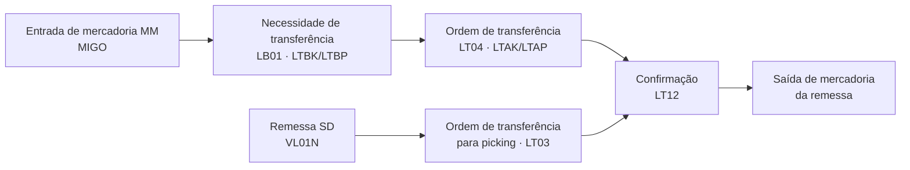

# SAP WM - Study

> Nível: noção
> Warehouse Management clássico (LE-WM) do ECC e o seu destino no S/4HANA. Estudo de leitura, sem prática no
> trial. Relacionados: [SAP-EWM-erp-study](https://github.com/igor-barral/SAP-EWM-erp-study), [SAP-MM-erp-study](https://github.com/igor-barral/SAP-MM-erp-study),
> [SAP-SD-erp-study](https://github.com/igor-barral/SAP-SD-erp-study), [SAP-Order-to-Cash-erp-study](https://github.com/igor-barral/SAP-Order-to-Cash-erp-study),
> [SAP-S4HANA-Migration-erp-study](https://github.com/igor-barral/SAP-S4HANA-Migration-erp-study).

## Objetivo

O WM clássico controla o estoque no nível de **posição de depósito** (endereço físico), abaixo do nível de
depósito do MM. Ele ainda roda em muitos ECC, e todo projeto de migração para S/4HANA precisa decidir o que
fazer com ele. Este repositório é de noção: vocabulário, tabelas para reconhecer em código antigo e o destino
do módulo.

Ao concluir este estudo você deverá ser capaz de responder perguntas como:

- Por que o WM não tem futuro no S/4HANA?
- O que um projeto de migração faz com ele?
- O que são ordem de transferência e necessidade de transferência?
- Qual a diferença entre o estoque no MM e o estoque no WM?

## Ponte

Num WMS próprio ou num ERP de logística, é comum ter a tabela `enderecos` (rua, prédio, nível) e uma tabela
de `tarefas` de movimentação geradas a partir do pedido. O WM é isso: o MM sabe que há 100 unidades no
depósito 0001; o WM sabe que 60 estão na posição `01-02-03` e 40 na `01-05-01`, e gera a tarefa de quem vai
buscar.

## Conteúdo

### Estrutura

| Nível | Significado | Tabela |
|---|---|---|
| Número do depósito (*warehouse number*) | O armazém físico controlado pelo WM, atribuído a centro/depósito do MM | configuração (`T300`) |
| Tipo de depósito (*storage type*) | Área com regra própria (recebimento, prateleira, picking, expedição) | configuração (`T301`) |
| Área de depósito (*storage section*) | Subdivisão do tipo (itens de giro rápido, pesados) | configuração |
| Posição de depósito (*storage bin*) | O endereço físico | `LAGP` |
| Quanto | Quantidade de um material numa posição | `LQUA` |

### Documentos

| Documento | Transações | Tabelas |
|---|---|---|
| Necessidade de transferência (*transfer requirement*) | `LB01` (criar), `LB03` (exibir) | `LTBK`, `LTBP` |
| Ordem de transferência (*transfer order*) | `LT01` (criar), `LT03` (para remessa), `LT04` (a partir da necessidade), `LT12` (confirmar) | `LTAK`, `LTAP` |
| Consulta de estoque por posição | `LS24`, `LS26` | `LQUA` |

Confirme as transações no sistema; em ECC muito customizado é comum haver transações Z sobre esses objetos.

### Destino no S/4HANA

- O LE-WM **não é a direção estratégica** no S/4HANA. Ele aparece na *simplification list* e na matriz de
  *compatibility scope* (SAP Note 2269324), com direito de uso limitado no tempo. Confirme a data vigente e as
  condições na nota da SAP antes de citá-la.
- O sucessor é o **EWM** (embutido no S/4HANA ou descentralizado). Ver
  [SAP-EWM-erp-study](https://github.com/igor-barral/SAP-EWM-erp-study).
- Para cenários simples, o S/4HANA oferece o **Stock Room Management**, uma alternativa baseada no WM para
  depósitos sem necessidade dos recursos do EWM. Confirme a disponibilidade na release do projeto.

## Respostas

**Por que o WM não tem futuro no S/4HANA?**
Porque a SAP definiu o EWM como a solução de armazém do S/4HANA. O LE-WM foi colocado no escopo de
compatibilidade, com direito de uso limitado, e não recebe evolução.

**O que um projeto de migração faz com ele?**
Três caminhos comuns: migrar para o EWM embutido (processos completos de armazém), adotar o Stock Room
Management (depósitos simples) ou manter temporariamente o WM dentro do prazo de compatibilidade e planejar a
troca. Para o desenvolvedor, isso significa reescrever relatórios, interfaces com coletores e *enhancements*
que leem `LTAK`/`LTAP`/`LQUA`.

**O que são ordem e necessidade de transferência?**
A necessidade de transferência é o pedido de movimentação ("é preciso guardar este material"). A ordem de
transferência é a tarefa executável, com posição de origem, posição de destino e quantidade; é confirmada
quando a movimentação física termina.

**Qual a diferença entre estoque no MM e no WM?**
O MM controla o estoque por centro e depósito (`MARD`). O WM detalha esse saldo por posição física (`LQUA`).
Os dois precisam estar em equilíbrio; diferenças são resolvidas por inventário e pelos relatórios de
comparação de estoques.

## Referências

- SAP Help Portal: https://help.sap.com (busque "Warehouse Management (LE-WM)" na documentação do SAP ERP e
  "Stock Room Management" na do SAP S/4HANA).
- SAP Support Portal: https://me.sap.com (SAP Note 2269324, *Compatibility Scope Matrix*; exige login).
- SAP Community: https://community.sap.com (busque "LE-WM" e "Warehouse Management").
